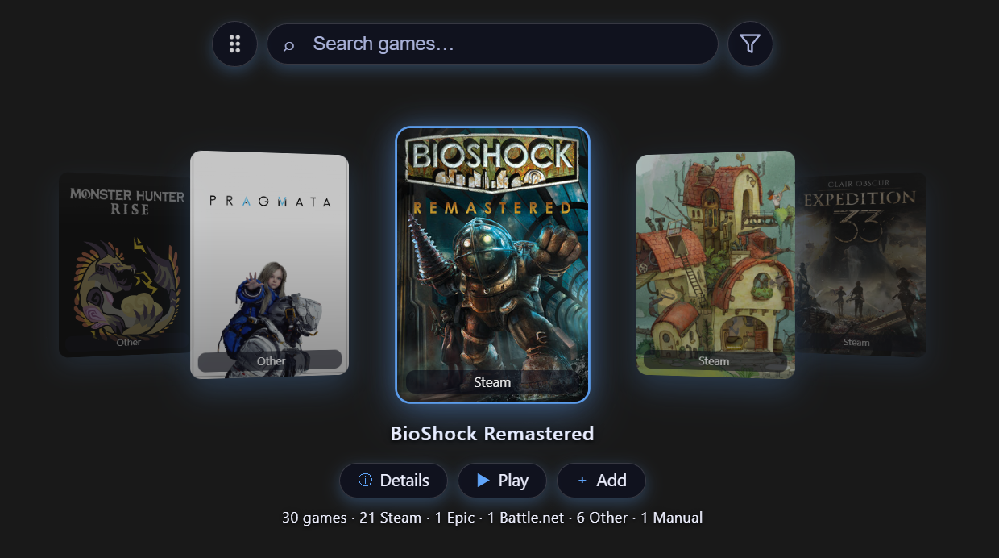

# Cardynox Launcher



## English

**Cardynox Launcher** is an ultra-lightweight desktop game launcher: a transparent, frameless widget that lives on your desktop, stays in the background of your screen and keeps all your games — Steam, Epic, or anywhere else — one click away. Built with **Rust + Tauri**, it idles at ~10 MB of RAM, launches instantly, and never gets in the way until you need it.

### Features

**Desktop widget**
- Transparent, borderless window rendered *behind* every other app — like part of your wallpaper
- Draggable by its handle; position and size are remembered across reboots, monitor swaps and resolution changes (scale-aware)
- Size slider in the tray: from "mini" up to 50% of the screen

**Game discovery**
- Reads your **Steam library** automatically
- Scans all drives at startup for **installed games** — real games only, regular programs are filtered out
- Platform badges under each cover (Steam / Epic / Other) and a live counter: *total · Steam · Epic · others*
- Manual **"Add game"**: pick the `.exe`, the visible name auto-fills (editable), cover optional, green *Add* / red *Cancel*

**Carousel**
- Cover cards navigated with the **mouse wheel** or the prev/next arrows
- Click a cover (pointer cursor) or press **Play** to launch the game instantly
- Optional **auto-scroll** ("Animate covers"): covers drift slowly and pause when you interact
- **Search bar** with live filtering, clear button and a subtle focus animation
- **Sort & filter**: alphabetically or by platform, plus per-platform visibility toggles

**Details (in-widget overlay, not a separate window)**
- Editable **visible name**
- Full install path including the `.exe` + "Open folder" button
- For non-Steam/Epic games: change the executable path and set **launch arguments**
- **Steam data**: achievements, time played, last session — plus disk size for every game
- **Remove from launcher** (with confirmation): the removal survives future rescans; re-enable later from tray → *Blocked games*, which verifies the game is still installed at its original path

**Covers**
- Optional **SteamGridDB** integration (your own API key, configured from the tray): downloads missing covers automatically in the background and caches them locally — works for any game, not only ones you own on Steam
- **Custom covers**: local image or GIF, removable at any time
- **Pan/center the cover art** exactly where you want; the adjustment is persisted and applied to both the widget and Details

**System tray**
- **Opacity** (5 levels, doesn't affect text/covers), **accent color** (10 options)
- **Language**: English / Spanish — every UI string and menu, switched live
- **Hide UI**: toggle individual pieces (drag handle, filter button, bottom buttons, game counter, navigation arrows)
- Show/hide the whole gadget · **Start with Windows** · Quit

**Light & safe by design**
- ~10 MB RAM running · ~11.6 MB executable · 2.6 MB installer
- Single instance only; no background services
- All data is local: `%APPDATA%\com.cardynox.launcher` (`cardynox.json` config + `covers/`)

### Install (Windows 10/11, x64)
Download the latest version from [Releases](https://github.com/kalipso-11/Cardynox-Launcher/releases). Run the `.exe` installer — it installs to *Program Files* and creates desktop and Start-menu shortcuts with the app icon. Requires WebView2 (the installer handles it).

### Build from source
Prerequisites: stable Rust toolchain + [Tauri v2 prerequisites](https://tauri.app/start/prerequisites/).

```bash
cd src-tauri
cargo build --release        # app → target/release/cardynox-launcher.exe
cargo tauri build            # NSIS installer → target/release/bundle/nsis/
```

> Dev note: if you change only files in `src-tauri/icons/*`, touch `tauri.conf.json` (or clean the package) before building, otherwise the Windows resource compiler may reuse stale icons.

---

## Español

**Cardynox Launcher** es un launcher de juegos ultraligero: un widget transparente y sin bordes que vive en tu escritorio, permanece al fondo de la pantalla y mantiene todos tus juegos — Steam, Epic o donde los tengas — a un clic de distancia. Hecho con **Rust + Tauri**, ocupa ~10 MB de RAM en reposo, arranca al instante y no se mete en el medio hasta que lo necesitás.

### Funcionalidades

**Widget de escritorio**
- Ventana transparente y sin bordes renderizada *detrás* de todas las aplicaciones — como parte del wallpaper
- Arrastrable por su manija; la posición y el tamaño se recuerdan entre reinicios, cambios de monitor y resolución (consciente de la escala)
- Control de **tamaño** en la bandeja: desde "mini" hasta el 50% de la pantalla

**Detección de juegos**
- Lee tu **biblioteca de Steam** automáticamente
- Escanea todos los discos al inicio buscando **juegos instalados** — solo juegos reales; los programas normales quedan filtrados
- Insignia de plataforma bajo cada portada (Steam / Epic / Otros) y contador en vivo: *totales · Steam · Epic · otros*
- **"Agregar juego"** manual: elegís el `.exe`, el nombre visible se autocompleta (editable), portada opcional, botón verde *Agregar* / rojo *Cancelar*

**Carrusel**
- Tarjetas de portadas navegables con la **rueda del mouse** o las flechas prev/next
- Click en una portada (cursor de dedo) o botón **Jugar** para lanzar el juego al instante
- **Auto-scroll** opcional ("Animar Portadas"): las portadas avanzan despacio y se detienen cuando interactuás
- **Buscador** con filtrado en vivo, botón de limpiar y animación sutil al enfocar
- **Orden y filtro**: alfabético o por plataforma, más toggles de visibilidad por plataforma

**Detalles (overlay dentro del widget, no es una ventana aparte)**
- **Nombre visible** editable
- Ruta completa de instalación incluyendo el `.exe` + botón "Abrir carpeta"
- Para juegos que no son Steam/Epic: cambiar la ruta del ejecutable y definir **argumentos de lanzamiento**
- **Datos de Steam**: logros, tiempo jugado, última sesión — más tamaño en disco para todos
- **Quitar del launcher** (con confirmación): la exclusión sobrevive a escaneos futuros; se re-habilita después desde bandeja → *Juegos bloqueados*, verificando que el juego siga instalado en su ruta original

**Portadas**
- Integración opcional con **SteamGridDB** (API key propia, se configura desde la bandeja): descarga automáticamente las portadas faltantes en segundo plano y las guarda en caché local — funciona para cualquier juego, no solo los que tenés en Steam
- **Portada personalizada**: imagen o GIF local, removible cuando quieras
- **Mover/centrar la imagen** de la portada justo donde quieras; el ajuste se persiste y se aplica tanto en el widget como en Detalles

**Bandeja del sistema**
- **Opacidad** (5 niveles, no afecta texto ni portadas), **color de acento** (10 opciones)
- **Idioma**: inglés / español — todos los textos y menús, conmutado en vivo
- **Ocultar UI**: activar/desactivar piezas individuales (manija de arrastre, botón de filtro, botones inferiores, contador de juegos, flechas de navegación)
- Mostrar/ocultar todo el gadget · **Iniciar con Windows** · Cerrar

**Ligero y seguro por diseño**
- ~10 MB de RAM en ejecución · ejecutable de ~11.6 MB · instalador de 2.6 MB
- Solo una instancia a la vez; sin servicios en segundo plano
- Todos los datos son locales: `%APPDATA%\com.cardynox.launcher` (config `cardynox.json` + carpeta `covers/`)

### Instalación (Windows 10/11, x64)
Descargá la última versión desde [Releases](https://github.com/kalipso-11/Cardynox-Launcher/releases). Ejecutá el instalador `.exe` — instala en *Program Files* y crea accesos directos en el escritorio y en el menú Inicio con el ícono de la app. Requiere WebView2 (el instalador lo resuelve).

### Compilar desde fuente
Requisitos: toolchain Rust estable + [prerequisitos de Tauri v2](https://tauri.app/start/prerequisites/).

```bash
cd src-tauri
cargo build --release        # app → target/release/cardynox-launcher.exe
cargo tauri build            # instalador NSIS → target/release/bundle/nsis/
```

> Nota de dev: si solo cambiás archivos en `src-tauri/icons/*`, tocá `tauri.conf.json` (o limpiá el paquete) antes de compilar, o el compilador de recursos de Windows puede reutilizar íconos viejos.
